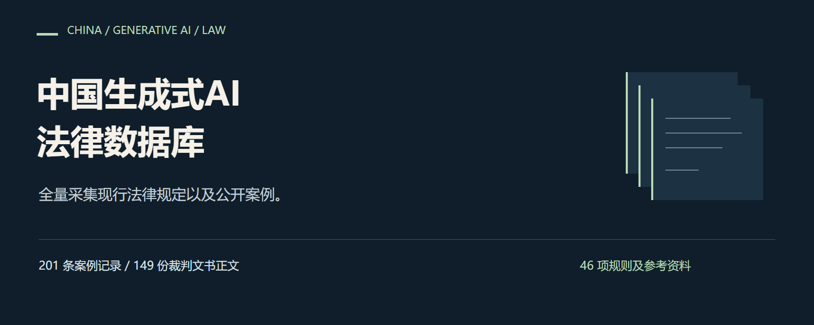

# 中国生成式AI法律数据库

全量采集现行法律规定以及公开案例。

| 内容 | 数量 |
|---|---:|
| 案例记录 | 229 条 |
| 裁判文书正文 | 163 份 |
| 无裁判文书正文的案例 | 66 条 |
| 法规主库 | 26 项 |
| 直接管理参考规范 | 6 项 |
| 标准索引 | 14 项 |

案例记录由163条有正文案例和66条无全文案例组成；规则及参考资料共46项。CASE-276依据山东高法官方介绍整理，本案完整分栏文字已保存，原判、案号、审级、裁判日期及生效情况仍待补；下游张店单篇显示作者删除，未恢复其原文。CASE-275依据央视新闻及具名法官受访报道整理，报道全文已保存，仍非裁判文书或法院独立发布。正文取得含已注明遮盖、省略及转载底本限制的公开脱敏版本，不等于全部取得法院签章原件或无删节文书。
