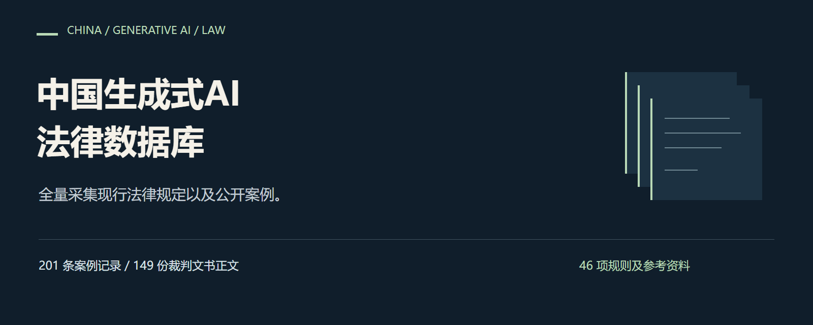

# 中国生成式AI法律数据库

持续采集中国大陆生成式AI法律规定及公开案例，保留裁判正文和可核对的来源材料；现有资料不代表全国全量覆盖。

[查看案件档案索引及旧号对应](索引.md)

| 内容 | 数量 |
|---|---:|
| 有效案件档案 | 297 份 |
| 历史编号跳转入口 | 8 个 |
| 已建档系列／独立子案 | 2 组／4 个 |
| 裁判文书正文 | 223 份 |
| 无裁判文书正文的档案 | 85 份 |
| 法规主库 | 26 项 |
| 直接管理参考规范 | 6 项 |
| 标准索引 | 14 项 |

223份裁判文书归属212份有效档案，85份有效档案尚无裁判正文。CASE是档案标识。同一纠纷的不同程序和同源系列的独立子案分别在主档案下展示。规则及参考资料共46项。

[CASE-357](案例/CASE-357.md)收录车辆贬值纠纷的一审判决及二审公开转录。[CASE-359](案例/CASE-359.md)补列思明法院通稿的刊载日期，准确裁判日期及原判待核。[CASE-367](案例/CASE-367.md)收录黑龙江高院发布的铁锋法院调解案，正式调解文书待补。[CASE-368](案例/CASE-368.md)至[CASE-371](案例/CASE-371.md)涉及人脸识别真实性争议和AI回答的证据审查，四案共保存五份裁判文书。

恢复[CASE-209](案例/CASE-209.md)，收录北京互联网法院署名评析中的AI动漫化切条视频案及相关出处，独立一审判决和准确裁判日期待补。[CASE-223子案02](案例/子案/CASE-223-子案02.md)补案号（2025）京0491民初12318号。另补CASE-008、012、018、073、114、206和208的期刊及出处信息。

同一纠纷的不同程序已归档：014→011、033→012、118→117、143→142、155→154、107→208。旧号均保留跳转，各审级分析和全文分别保留。[CASE-208](案例/CASE-208.md)新增（2025）沪0116民初2354号实体一审完整可见文字；原审管辖2354号之一独立裁定、图稿附件、原始证据及各项生效／履行缺口仍按档案说明保留。

新增[CASE-318](案例/CASE-318.md)至[CASE-322](案例/CASE-322.md)、[CASE-330](案例/CASE-330.md)至[CASE-344](案例/CASE-344.md)，恢复[CASE-086](案例/CASE-086.md)。另补入[CASE-066](案例/CASE-066.md)、[CASE-210](案例/CASE-210.md)、[CASE-260](案例/CASE-260.md)、[CASE-265](案例/CASE-265.md)的裁判正文。法院介绍、期刊评析、媒体报道和裁判正文分别列示，具体程序和材料缺口见档案。

此前新增[CASE-323](案例/CASE-323.md)至[CASE-329](案例/CASE-329.md)，包括AI合成图片异议、商品图改作、数字人与视频交付及AI漫剧制作。六案保存裁判正文，CASE-327保存深圳中院典型案例材料，两审判决仍待补。[CASE-257](案例/CASE-257.md)补入上海一中院二审正文，独立一审及鉴定附件待补。[CASE-208](案例/CASE-208.md)补充同号二审文字版核对说明。

新增[CASE-317](案例/CASE-317.md)，收录东湖法院在设备款纠纷中训诫提交AI问答截图的代理律师。两篇具名采访及训诫时点差异已记录，案号、裁判正文及生效状态待补。[CASE-229](案例/CASE-229.md)补齐数字经济汇编原发及转载、知识产权十大案例与首期研讨原发。[CASE-256](案例/CASE-256.md)补入湖北高院第20号案例原发。[CASE-309](案例/CASE-309.md)补入湖北高院年度典型案例原发，据此确认一审生效。

新增[CASE-315](案例/CASE-315.md)李顺心等五人AI换脸突破政务认证案，保存广东高院典型介绍完整相关原文，保留两审案号、完整文书及准确裁判日期等缺口；[CASE-310](案例/CASE-310.md)补充不同案关联。新增[CASE-316](案例/CASE-316.md)余杭AI换脸盗取电商账户案，保存央视原发节目出处、裁判主文局部文字及案件分析；审理法院、节目所述日期和三人刑罚已核，案号、完整原判、审级及生效仍缺。局部主文不计完整裁判正文，当批正文总数仍为196份。

新增[CASE-314](案例/CASE-314.md)武陵区AI虚假废品收购单诈骗案，保存法院系统署源转载的相关案情及审理介绍原文、出处和链接；正式案号、原判、裁判日期及生效状态仍待补。[CASE-265](案例/CASE-265.md)早期曾据非官方摘要补充候选案号和日期，现已核对公开脱敏判决版本。

[CASE-171](案例/CASE-171.md)收录钟某、李某两起独立劳动纠纷，旧号172可直接进入对应子案。两份二审判决沿用原路径，独立一审及证据、履行等缺口见各子案。[CASE-223](案例/CASE-223.md)收录演员分别起诉短剧制作方和获授权播出方的两案，旧号224可直接进入对应子案。两案共用法院报道，子案02案号据开庭公告核实。子案01案号及两案判决原文、日期和金额待补。

新增[CASE-308](案例/CASE-308.md)梅县法院（2025）粤1403民初3214号案件分析及完整判决文字，小额诉讼终审；与CASE-261的3215号为不同被告、作者及图片的独立纠纷。原图、生成记录、登记与转让附件、签章影印件和履行材料仍待补。新增[CASE-310](案例/CASE-310.md)盗用大模型算力案、[CASE-311](案例/CASE-311.md)AI恶搞表情包纠纷和[CASE-312](案例/CASE-312.md)地暖AI证据纠纷，保存案件分析、官方相关原文及出处链接。三案裁判正文均未取得，案号、裁判日期、生效及材料版本等缺口按各案说明保留；311的一审判决与二审调解、312的诉请金额与处理结果分别记载。新增CASE-309保存武汉中院（2023）鄂01知民初481号一审公开转载判决及湖北省知识产权局官方原发介绍，并与CASE-230南京API商标案区分；法院签章原件、证据附件、确切生效日期及独立生效证明仍待补。此前新增CASE-304—307四案：304—306分别保存完整可见裁判文字，307保存鼓楼法院官方案情发布、法官说法及出处链接，仍缺案号、原判、裁判日期和独立生效材料；217、285补充相似案件参照，不合并独立纠纷。新增CASE-286—303十八案，分别保存案件分析和完整可见裁判文字（十七份民事判决、一份民事裁定）。CASE-297可见底本未单列法院及文种页眉，统一标题据案号、原题、主文及落款核定，未补造页眉。独立审级、原始证据附件、签章影印件及生效等缺口仍按各案说明保留。CASE-259保留法院典型汇编、《法人》采访、上海高院法官说法及总台中国之声采访四个版本；一审日期据发布会报道，二审撤诉具体日期及原判仍缺，法院裁判介绍、法官释法、企业说明和律师点评分开。CASE-277保存二审公开HTML转载文字，法院原站、导入链、影印件、独立一审及证据附件等仍待核/补。CASE-276依据山东高法官方介绍整理，本案完整分栏文字已保存，原判、案号、审级、裁判日期及生效情况仍待补；下游张店单篇显示作者删除，未恢复其原文。CASE-275依据央视新闻及具名法官受访报道整理，报道全文已保存，仍非裁判文书或法院独立发布。正文取得含已注明遮盖、省略及转载底本限制的公开脱敏版本，不等于全部取得法院签章原件或无删节文书。
