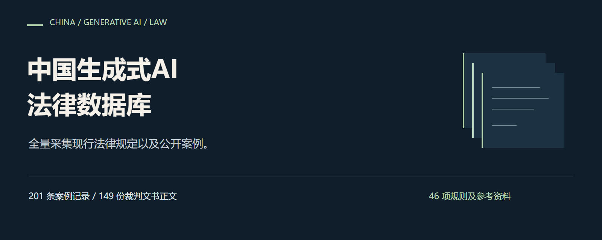

# 中国生成式AI法律数据库

持续采集中国大陆生成式AI法律规定及公开案例，保留裁判正文和可核对的来源材料；现有资料不代表全国全量覆盖。

[查看案件档案索引及旧号对应](索引.md)

| 内容 | 数量 |
|---|---:|
| 有效案件档案 | 257 份 |
| 历史编号跳转入口 | 8 个 |
| 已建档系列／独立子案 | 2 组／4 个 |
| 裁判文书正文 | 196 份 |
| 无裁判文书正文的档案 | 69 份 |
| 法规主库 | 26 项 |
| 直接管理参考规范 | 6 项 |
| 标准索引 | 14 项 |

196份裁判文书归属188份有效档案，69份有效档案尚无裁判正文。CASE是档案标识。同一纠纷的不同程序和同源系列的独立子案分别在主档案下展示。规则及参考资料共46项。

同一纠纷的不同程序已归档：014→011、033→012、118→117、143→142、155→154、107→208。旧号均保留跳转，各审级分析和全文分别保留。[CASE-208](案例/CASE-208.md)新增（2025）沪0116民初2354号实体一审完整可见文字；原审管辖2354号之一独立裁定、图稿附件、原始证据及各项生效／履行缺口仍按档案说明保留。

[CASE-171](案例/CASE-171.md)收录钟某、李某两起独立劳动纠纷，旧号172可直接进入对应子案。两份二审判决沿用原路径，独立一审及证据、履行等缺口见各子案。[CASE-223](案例/CASE-223.md)收录演员分别起诉短剧制作方和获授权播出方的两案，旧号224可直接进入对应子案。两案共用法院报道，裁判原文、案号、日期和金额等仍待补。

新增[CASE-308](案例/CASE-308.md)梅县法院（2025）粤1403民初3214号案件分析及完整判决文字，小额诉讼终审；与CASE-261的3215号为不同被告、作者及图片的独立纠纷。原图、生成记录、登记与转让附件、签章影印件和履行材料仍待补。新增[CASE-310](案例/CASE-310.md)盗用大模型算力案、[CASE-311](案例/CASE-311.md)AI恶搞表情包纠纷和[CASE-312](案例/CASE-312.md)地暖AI证据纠纷，保存案件分析、官方相关原文及出处链接。三案裁判正文均未取得，案号、裁判日期、生效及材料版本等缺口按各案说明保留；311的一审判决与二审调解、312的诉请金额与处理结果分别记载。新增CASE-309保存武汉中院（2023）鄂01知民初481号一审公开转载判决及湖北省知识产权局官方原发介绍，并与CASE-230南京API商标案区分；法院原始文书、独立二审、证据附件及生效等缺口保留。此前新增CASE-304—307四案：304—306分别保存完整可见裁判文字，307保存鼓楼法院官方案情发布、法官说法及出处链接，仍缺案号、原判、裁判日期和独立生效材料；217、285补充相似案件参照，不合并独立纠纷。新增CASE-286—303十八案，分别保存案件分析和完整可见裁判文字（十七份民事判决、一份民事裁定）。CASE-297可见底本未单列法院及文种页眉，统一标题据案号、原题、主文及落款核定，未补造页眉。独立审级、原始证据附件、签章影印件及生效等缺口仍按各案说明保留。CASE-259保留法院典型汇编、《法人》采访、上海高院法官说法及总台中国之声采访四个版本；一审日期据发布会报道，二审撤诉具体日期及原判仍缺，法院裁判介绍、法官释法、企业说明和律师点评分开。CASE-277保存二审公开HTML转载文字，法院原站、导入链、影印件、独立一审及证据附件等仍待核/补。CASE-276依据山东高法官方介绍整理，本案完整分栏文字已保存，原判、案号、审级、裁判日期及生效情况仍待补；下游张店单篇显示作者删除，未恢复其原文。CASE-275依据央视新闻及具名法官受访报道整理，报道全文已保存，仍非裁判文书或法院独立发布。正文取得含已注明遮盖、省略及转载底本限制的公开脱敏版本，不等于全部取得法院签章原件或无删节文书。
